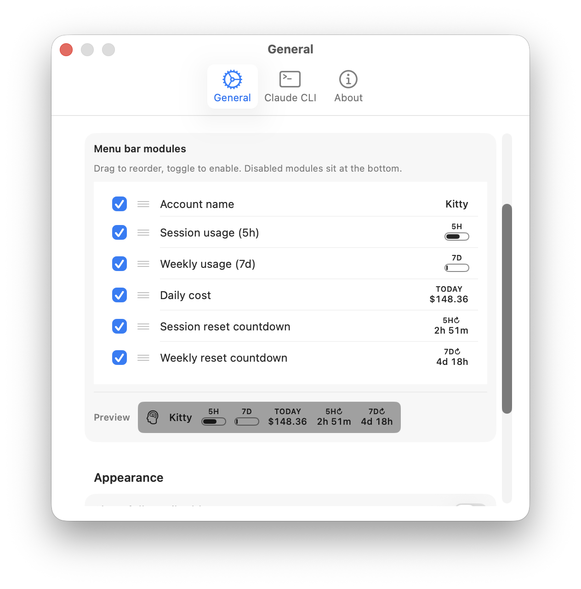

  
  
  
  
  

  
  
  
  

# CCSwitcher

CCSwitcher is a native macOS menu bar app for managing multiple Claude Code and Codex accounts, checking usage limits, and exploring local activity and estimated API-equivalent costs.

## Features

- **Claude Code accounts:** save and switch between accounts from the menu bar, with credentials backed up in the macOS Keychain.
- **Codex desktop profiles:** open separate Codex app profiles for different accounts, each with its own credentials and desktop data. Activate a saved account for the default Codex CLI separately.
- **Usage dashboard:** view available usage windows and account information for each provider. Codex can use locally cached limits when a live fetch is unavailable.
- **Activity and cost:** explore locally recorded usage, model breakdowns, turns, active minutes, and lines written. Costs are estimates of equivalent API usage, not subscription charges or invoices.
- **Menu bar and widgets:** configure menu bar modules and use macOS desktop widgets to view usage and activity.
- **Native macOS experience:** light and dark appearance, privacy obfuscation, localized UI, and Sparkle updates.

Download the latest release from [GitHub Releases](https://github.com/vientooscuro/CCSwitcher/releases/latest). For building from source, see [BUILD_GUIDE.md](BUILD_GUIDE.md).

## Accounts and profiles

### Claude Code

CCSwitcher stores account credential backups in its own Keychain entry and switches the active Claude Code credentials and the `oauthAccount` information in `~/.claude.json`. The backup is separate from the live Claude Code Keychain entry. An older `~/.ccswitcher/backups.json` store is migrated to Keychain when found.

Switching changes the credentials shared by Claude Code processes using the default configuration. It does not isolate running sessions per account; avoid switching while a session must remain on its original account. Login and token refresh depend on the installed Claude CLI and the provider's authentication services, and reauthentication may still be required.

### Codex

CCSwitcher can import the account signed in to the default Codex app or open a new desktop profile for login. The default profile uses `~/.codex` and the standard Codex desktop data directory. Additional profiles use separate `home` and `desktop` directories under `~/Library/Application Support/CCSwitcher/CodexProfiles/<account-id>/`; a short path under `~/Library/CCS/` points to each isolated home for launch. Each profile has its own configuration and credentials, so settings and history are not automatically shared between profiles.

Opening a desktop account does not replace another profile's credentials. **Activate for CLI** is a separate operation that writes the chosen account's credentials to the default `~/.codex/auth.json`, after preserving recognized current credentials. If the current CLI credentials do not match a saved account, they are left unchanged. A profile may require signing in again in its Codex window.

Codex statistics can cover the selected profile or all discovered profiles. The latter combines local histories; it is not a provider-side account billing report.

## Cost estimates and local caches

CCSwitcher reads local session records and applies model prices from a bundled LiteLLM snapshot or a refreshed snapshot when available. Estimates include recorded input, output, and supported cache token categories, with applicable model pricing rules. They are not amounts billed for a subscription or an API invoice. Missing session records, unavailable or unpriced models, pricing changes, and incomplete metadata can make totals incomplete or inaccurate. Unknown prices contribute no estimated cost; check model coverage before comparing totals. Claude cost verification details are in [COST_VERIFICATION.md](COST_VERIFICATION.md).

To avoid repeatedly parsing unchanged files, CCSwitcher keeps local, versioned parse caches keyed by file modification time:

- Claude records come from `~/.claude/projects/`; parsed entries, token and activity metadata, and pricing metadata are cached in `~/Library/Application Support/CCSwitcher/session-parse-cache-v2.json`.
- Codex reads active and archived rollout files from the selected homes, including supported `.jsonl` and `.jsonl.zst` files. Its current-profile cache is `ccswitcher-session-cache.json` in that profile's home; the all-profile cache is `~/.codex/ccswitcher-all-session-cache.json`. Cached observations support deduplication of replayed session history.

The caches are derived data, not credentials or complete transcripts. They contain local activity and usage metadata and should be treated as private. A changed file is reparsed; a cache version change causes a rebuild. Missing, inaccessible, or unreadable source files cannot contribute complete results, and timestamps are used to detect file changes. Pricing snapshots are cached separately; a stale or unavailable network snapshot falls back to bundled pricing.

## Screenshots

   
  <em>Light Theme</em>

   
  <em>Dark Theme</em>

   
  <em>Desktop Widget</em>

   
  <em>Configurable menu bar modules — account, session/weekly usage, daily cost, and reset countdowns</em>

   
  <em>Drag to reorder and toggle modules, with a live preview</em>

## Demo

  <video src="https://github.com/user-attachments/assets/ca37eaae-e8d8-4557-995e-bc154442c833" width="864" autoplay loop muted playsinline />

